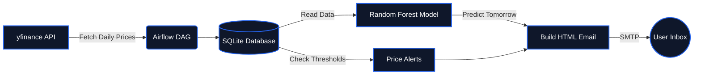

<div align="center">
  <!-- Circular Logo -->
  
  
  <br>

  <!-- Title in Dark Theme Color -->
  <h1 style="color: #1a2332; font-size: 3em; margin-bottom: 0;">Market Pulse</h1>
  <p style="color: #64748b; font-size: 1.2em; letter-spacing: 1px;"><b>Discover Opportunities. Understand the Market.</b></p>

  <!-- Badges -->
  <p>
    <a href="https://python.org"></a>
    <a href="https://flask.palletsprojects.com/"></a>
    <a href="https://airflow.apache.org/"></a>
    <a href="https://sqlite.org/"></a>
    <a href="https://scikit-learn.org/"></a>
    <a href="https://docker.com"></a>
  </p>
</div>

---

<div style="background-color: #0f172a; color: #e2e8f0; padding: 20px; border-radius: 8px; border-left: 5px solid #2563eb;">
  <h3 style="color: #ffffff; margin-top: 0;">Overview</h3>
  <p style="margin-bottom: 0;">Market Pulse is a full-stack data product that demonstrates how modern data engineering, machine learning, and web development combine to solve a real analytical problem. The platform fetches daily equity prices, computes technical features, trains a Random Forest model, and delivers a personalized performance digest by email, all orchestrated seamlessly by Apache Airflow.</p>
</div>

<br>

<div align="center">
  
</div>

---

## Key Features

<table>
  <tr>
    <td width="50%" valign="top">
      <h3>Live Market Tracking</h3>
      <p>Track real-time prices for US (NASDAQ/NYSE), Pakistani (PSX), and International stocks with interactive Chart.js visualizations and dynamic hover tooltips.</p>
    </td>
    <td width="50%" valign="top">
      <h3>AI Price Forecasting</h3>
      <p>Random Forest regression trained on lagged prices, SMA, and RSI. Predicts next-day close with a calculated confidence range (no fake precision).</p>
    </td>
  </tr>
  <tr>
    <td width="50%" valign="top">
      <h3>News Sentiment Analysis</h3>
      <p>Fetches latest headlines via yfinance and scores them as Bullish, Bearish, or Neutral using VADER NLP to gauge market mood.</p>
    </td>
    <td width="50%" valign="top">
      <h3>Automated Daily Digests</h3>
      <p>Apache Airflow runs a cron job daily. It fetches prices, retrains models, checks user price alerts, and sends an HTML report via SMTP.</p>
    </td>
  </tr>
</table>

---

## Technology Stack

<details>
<summary><b>Click to view full stack details</b></summary>
<br>

| Layer | Technology | Purpose |
| :--- | :--- | :--- |
| **Frontend** | HTML, CSS, Vanilla JS | Responsive UI, Dark Mode toggle |
| **Visualization** | Chart.js | Interactive price charts & trends |
| **Backend** | Flask (Python) | REST API, Web Server, Routing |
| **Database** | SQLite | Relational data, Watchlists, Alerts |
| **Orchestration**| Apache Airflow | Daily ETL Pipeline scheduling & ML retraining |
| **Machine Learning**| Scikit-Learn | Random Forest Regressor forecasting |
| **NLP** | VADER Sentiment | Rule-based news headline scoring |
| **Data Source** | yfinance | Free, real-time stock data API |
| **Containerization**| Docker Compose | Isolated environment for Airflow |

</details>

---

## Getting Started

<details>
<summary><b>Step 1: Start the Flask Dashboard (Local)</b></summary>

```bash
# Clone the repository
git clone https://github.com/Hifza-Khalid/market-pulse.git
cd market-pulse

# Create and activate virtual environment
python -m venv venv
venv\Scripts\activate  # Windows
# source venv/bin/activate  # Mac/Linux

# Install dependencies
pip install -r requirements.txt

# Run the web app
python run.py
```
Access the dashboard at **http://localhost:5000**
</details>

<details>
<summary><b>Step 2: Start the Airflow Pipeline (Docker)</b></summary>

```bash
# Build and start Airflow services in the background
docker compose up -d

# Verify all containers are running and healthy
docker compose ps
```
Access the Airflow UI at **http://localhost:8081** (Login: `admin` / `admin`)
</details>

---

## Architecture Pipeline



---

## Project Structure

<details>
<summary><b>Click to view folder structure</b></summary>
<br>

```text
market-pulse/
├── app.py                  # Flask Backend & API Routes
├── schema.sql              # SQLite Database Schema
├── requirements.txt        # Python Dependencies
├── docker-compose.yaml     # Airflow Docker Setup
├── Dockerfile              # Custom Airflow Image
├── docs/                   # Demo Assets
│   └── demo.gif            # Animated Demo
├── templates/
│   └── index.html          # Single-file Frontend (HTML/CSS/JS)
├── ml/
│   ├── features.py         # Feature engineering (RSI, SMA, etc.)
│   ├── train.py            # Random Forest training script
│   └── predict.py          # CLI inference script
├── dags/
│   └── market_pulse_dag.py # Airflow daily automation DAG
├── models/                 # Saved ML models (.pkl)
└── data/
    └── market_pulse.db     # SQLite Database (gitignored)
```
</details>

---

## Best Practices Implemented

- **Idempotent Pipelines:** `INSERT OR REPLACE` ensures duplicate data is never stored if a DAG is re-run.
- **Honest ML:** Forecasts include a confidence range derived from model residuals rather than guessing exact numbers.
- **Secrets Management:** Sensitive data (like Gmail App Passwords) are securely handled via `.env` variables and isolated from Git via `.gitignore`.
- **Time-based Split:** Train/test split is chronological (80/20) to prevent look-ahead bias in the ML model.

<br>
<div align="center">
  <p style="color: #64748b; font-size: 0.9em;">Built with care for everyday investors.</p>
</div>
